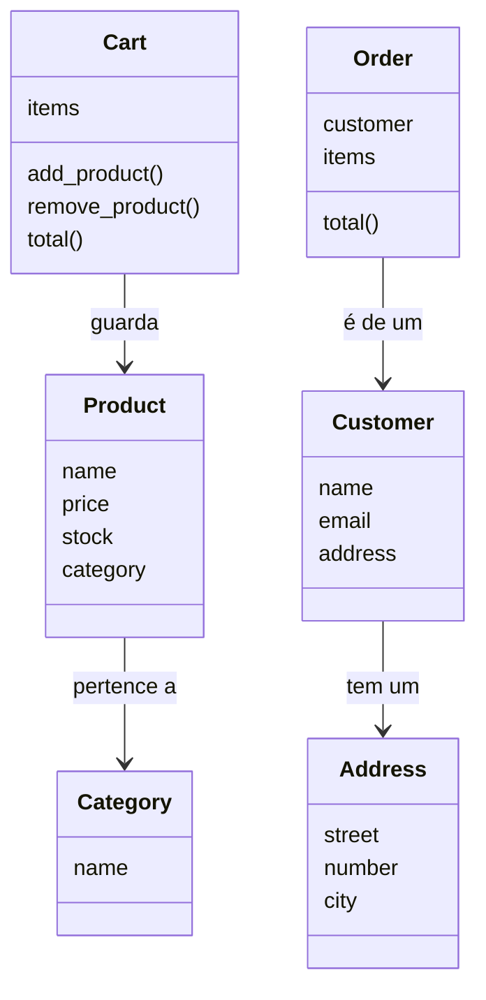

# 🧩 Diagrama de classes: o desenho do sistema

O **diagrama de classes** é um desenho que mostra:
- quais **classes** o sistema tem (cada caixa é uma classe);
- o que cada classe **guarda** (atributos);
- o que cada classe **sabe fazer** (métodos, que terminam com `()`);
- como as classes **se relacionam** (as setas).

É como a **planta de uma casa**: a gente desenha antes de construir.

## Nossa loja

## O que é cada classe

| Classe | Em português | O que guarda |
|---|---|---|
| `Category` | Categoria | o nome da categoria |
| `Product` | Produto | nome, preço, estoque e categoria |
| `Address` | Endereço | rua, número e cidade |
| `Customer` | Cliente | nome, e-mail e endereço |
| `Cart` | Carrinho | os produtos escolhidos |
| `Order` | Pedido | o cliente e os produtos comprados |

## Como ler as setas

| Seta | Lê-se assim |
|---|---|
| `Product → Category` | "Um **produto pertence a** uma categoria" |
| `Customer → Address` | "Um **cliente tem um** endereço" |
| `Cart → Product` | "Um **carrinho guarda** produtos" |
| `Order → Customer` | "Um **pedido é de um** cliente" |

> Nas próximas aulas, o desenho vai ganhar classes novas, como `User` (herança) e as formas de pagamento.
